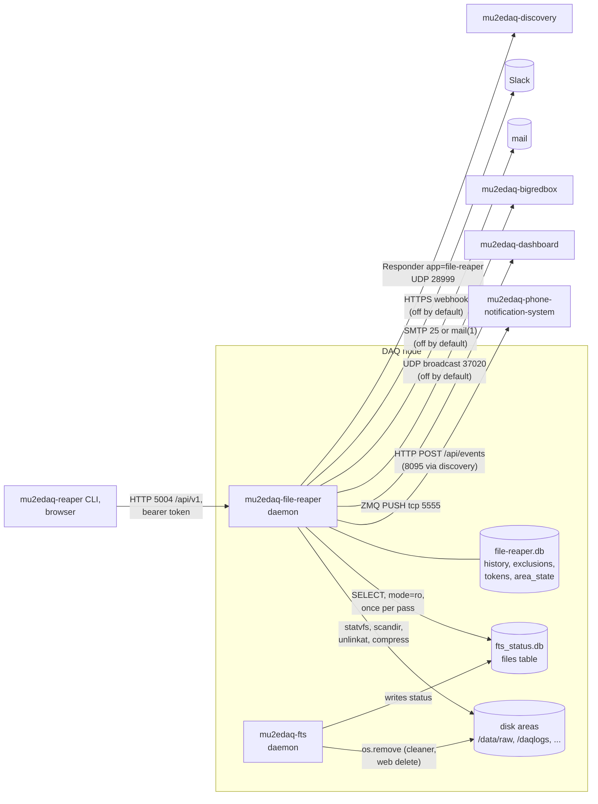
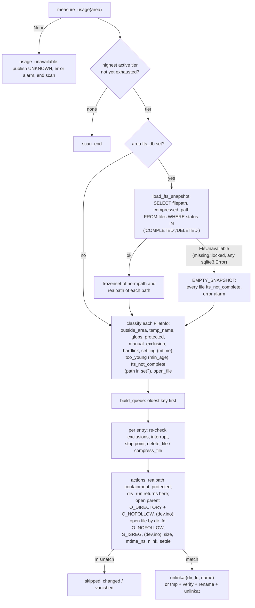

# mu2edaq-file-reaper

> Policy-driven disk cleanup daemon that measures configured DAQ disk areas, alarms at
> warning/critical/full tiers, and compresses or deletes files in LRU or age order (raw
> data gated on mu2edaq-fts transfer status) down to a low-water mark, with an audit
> history, web UI, REST API and CLI

| | |
|---|---|
| Repository | `Mu2e/mu2edaq-file-reaper` (public) |
| Version | 0.1.0, tag `t00.01.00` |
| Language | Python 3.9 (9,980 lines incl. tests), bash, PowerShell |
| Ports | 5004/tcp web UI and `/api/v1` (`CRS_PORT_HTTP`); optional second API-only port |
| Depends on | `mu2edaq-fts` (SQLite read), `mu2edaq-discovery` (import), `mu2edaq-phone-notification-system` (import + HTTP), `mu2edaq-dashboard` (ZMQ PUSH 5555), `mu2edaq-bigredbox` (UDP 37020) |
| Design record | [`DESIGN.md`](DESIGN.md) (goals, water-mark math, algorithm, schema). This page does not repeat it. |
| Review | 2026-10-06, branch `mu2e-sept-mega-review`, findings in [`ISSUES-PENDING.md`](ISSUES-PENDING.md) |

## Purpose

One reaper runs per DAQ node. For each configured *area* (a directory on a
local filesystem) it measures used space the way `df` does, activates the
`warning`, `critical` or `full` tier when used space crosses that tier's
trigger, and then compresses or deletes the oldest eligible files until used
space falls to the tier's stop point. It is the actuating counterpart of
`mu2edaq-diskwatcher`, which only observes. It **deletes files**; every design
choice below is about when it may not.

Raw-data areas carry an `fts_db` gate: a file is eligible only if
`mu2edaq-fts` records it as `COMPLETED` or `DELETED`. Areas without a gate
(logs, scratch) are governed by age and globs alone.

## Architecture

### Fan-out

### The FTS gate inside one pass

What the gate compares is exactly one thing: whether the scanned path string
(or that path minus a compression suffix) is in the set
(`fts_gate.py:30-38`). No size, inode, timestamp or checksum column of the
`files` row is read (`fts_gate.py:56`). The consequences are FR-001 and FR-002;
the full read contract is in [`INTERFACES.md`](INTERFACES.md#3-the-mu2edaq-fts-read-contract).

## Components

Module responsibilities are listed in the package `CLAUDE.md` and
[`DESIGN.md`](DESIGN.md) section 5; the table below adds only where each
safety-relevant decision is made.

| Module | Decision it owns | Where |
|---|---|---|
| `config.py` | which areas exist; system-root and depth refusal; `fts_db` realpath | `config.py:155-249`, refusal `:188-197` |
| `settings.py`, `cli.py` | layered settings (defaults, YAML, `.env`, env, CLI); dry-run flag | `cli.py:104-147`, `settings.py:29-46` |
| `usage.py` | `df`-convention usage; `fake_usage_file` test hook | `usage.py:21-54` |
| `watermarks.py` | trigger/stop hysteresis, tier selection | pure; `watermarks.py:36-93` |
| `scanner.py` | enumeration: no symlinks, same `st_dev`, parent `(dev, ino)` | `scanner.py:35-106` |
| `fts_gate.py` | the FTS snapshot | `fts_gate.py:44-73` |
| `eligibility.py` | per-file verdict and rejection reason | pure; `eligibility.py:75-106` |
| `policies.py` | ordering key: LRU `max(atime, mtime)`, Age `mtime` | `policies.py:24-28` |
| `actions.py` | the only code that modifies a file; identity re-verification | `actions.py:88-170`, compress `:231-330` |
| `reaper.py` | one scan of one area: passes, queue, act loop, stall check | `reaper.py:286-669` |
| `scheduler.py` | ticks, manual scans, pause/disable, dry-run requests | `scheduler.py:22-256` |
| `web/auth.py`, `auth.py` | bearer tokens, admin session, CSRF | `web/auth.py:68-135` |
| `notify/` | five channels, rate limiting | `notify/channels.py:55-245` |
| `mu2edaq_reaper_cli/` | operator CLI over `/api/v1`, 0600 token cache | `tokencache.py:45-96` |

Threading: main thread (signals), `reaper-scheduler`, a `ThreadPoolExecutor`
of `reaper.workers` scan workers, `reaper-notifier`, and one or two Werkzeug
server threads. Areas on one `st_dev` share a lock and never act concurrently
(`reaper.py:113-120`, `:304`). Details: `DESIGN.md` section 8.

## Deletion safety: claims checked against the code

Each row is a property the README, `CLAUDE.md` or `DESIGN.md` asserts, and what
the code actually does.

| Property | Verdict | Evidence and caveats |
|---|---|---|
| Dry run exists at three levels | **holds** | global (`settings.py:76`, env `MU2EDAQ_FILE_REAPER_DRY_RUN`, `--dry-run`), per area (`config.py:236`), per request (`scheduler.py:106,116`); OR-ed at `reaper.py:186`. `delete_file` and `compress_file` return before opening anything (`actions.py:160-162`, `:241-244`); temp sweep and dir pruning are skipped (`reaper.py:342`, `:520`). No write path bypasses it. |
| Dry run is the shipped default | **partly** | Code default `false`; node config `mu2e-file-reaper-dl-01.yaml:15` is `true`; the reference config the start script loads by default is `false` (FR-008). The `--dry-run` CLI flag can only turn it on (`cli.py:137`); `MU2EDAQ_FILE_REAPER_DRY_RUN=0`, and also an exported but empty `MU2EDAQ_FILE_REAPER_DRY_RUN=` (`settings.py:49`), turn a YAML `true` off (FR-016 m). |
| Refuses system roots | **exact match only** | `config.py:190`. `/usr/lib`, `/var/lib`, `/home/mu2edaq` are accepted (FR-005). |
| Refuses depth < 2 | **holds** | `config.py:193-197`, measured on the realpath, so a symlink to `/` or `/usr` is refused. `..` is removed by `abspath` before the check. |
| Never follows symlinks | **holds** | scanner skips them (`scanner.py:70-72`); action opens use `O_NOFOLLOW` and verify the parent's `(dev, ino)` (`actions.py:96-111`), which also catches a swapped intermediate directory. |
| Never crosses a filesystem boundary | **holds for enumeration, not for bind mounts or the temp sweep** | `st_dev` checks at `scanner.py:60,85`. A bind mount of another directory from the *same* device is invisible to that test (FR-006). `sweep_temp_files` has no `st_dev` test at all (FR-016 g). |
| Areas cannot overlap | **not checked** | no nesting test; an outer ungated area applies its policy to an inner gated area's files (FR-006). |
| Identity re-verified between scan and act | **holds** | `(dev, ino)` of parent and file, `S_ISREG`, size, `mtime_ns`, `nlink`, settle (`actions.py:133-148`); unlink is `unlinkat(dir_fd, name)` (`:167`). Residual window: between `close(fd)` (`:166`) and `unlinkat`, a rename-over of the same name would be unlinked instead. POSIX has no unlink-by-descriptor; the window is microseconds and needs a concurrent writer renaming onto an old, eligible name. Compression is only partly descriptor-based: the temp file, `utime` and `rename` use path names (`actions.py:253,298,302`); a parent directory swapped after verification would receive the archive while the original is unlinked from the verified directory. No bytes are lost and it needs write access above the area, so it is noted, not filed. |
| Identity bound to what FTS shipped | **does not hold** | the re-verification compares against the reaper's own scan, not FTS's record (FR-001). |
| FTS gate fails closed | **holds** | missing file, open failure, any `sqlite3.Error` during the read, including a partially readable database, raises `FtsUnavailable` and the partial set is discarded (`fts_gate.py:46-72`); the engine substitutes `EMPTY_SNAPSHOT` and alarms (`reaper.py:411-420`). A readable but empty `files` table also allows nothing, but raises no FTS alarm; it surfaces as `policy_insufficient` with `fts_not_complete` counts. |
| FTS gate means "shipped and verified" | **does not hold** | `COMPLETED` is accepted regardless of `checksum_verified`/`checksum_match` (FR-002). |
| Compression never replaces a file with an unverified archive | **holds, with a weak gzip check** | temp file, fsync, source re-stat, verify, ratio guard, rename, then unlink (`actions.py:245-310`). For gzip, `compress_verify: crc` compares the trailer CRC the writer produced with the CRC of the bytes read; it is a self-consistency check, not a decompression of what reached the disk. Other algorithms get a full decompression pass (`actions.py:207-228`). |
| Never acts without a usage measurement | **first measurement only** | the pass-start check holds (`reaper.py:357-368`); a failing re-measurement mid-pass reuses the stale sample (`reaper.py:502,644`, FR-014). |
| `fake_usage_file` cannot reach production unnoticed | **weak** | YAML-only (`cli.py:90`), one startup WARNING (`cli.py:216-218`), a badge on `/config`. Not refused when `dry_run` is false, absent from `/api/v1/health` and discovery. Deletions it drives are still limited to gate- and age-eligible files (FR-016 a). |
| Destructive API routes need a token | **holds** | every POST/DELETE carries `require_scope("operate"|"admin")` (`web/api_v1.py:161-211,262-303,368-442`); anonymous gets 401 (`web/auth.py:127-128`). No route deletes an arbitrary path or changes area config; the most destructive actions are "run the configured policy now", enabling a config-disabled area, and removing an exclusion. |
| CSRF on the admin UI | **holds** | session-authenticated mutations require `X-CSRF-Token` or `csrf_token` (`web/auth.py:104-107,129-130`); cookie `HttpOnly`, `SameSite=Lax` (`web/__init__.py:29-31`); the UI's `apiFetch` sends the header (`static/reaper.js:90-102`). Bearer and `X-Admin-Token` callers are not cookie-authenticated, so CSRF does not apply. |
| Secrets are redacted in the UI | **does not hold** | `/config` is unauthenticated and prints the raw YAML (FR-003). |
| Manual exclusions are honoured before every action | **holds for globs and canonical paths only** | re-checked per entry (`reaper.py:608-611`); `regex` kind and symlinked-path exclusions match nothing (FR-004). |

## Interfaces

Summarised here, specified in [`INTERFACES.md`](INTERFACES.md):

- **HTTP** on 5004: server-rendered pages and REST API v1 under `/api/v1`,
  bearer tokens with scopes `read < operate < admin`, open reads by default.
- **Notifications out**: phone notification HTTP, dashboard ZMQ PUSH, Big Red
  Box UDP broadcast, SMTP or `mail(1)`, Slack webhook.
- **SQLite in**: the mu2edaq-fts `files` table, read-only.
- **Discovery**: `Responder(app="file-reaper")` with string-valued `meta`.
- **Files**: its own SQLite (or PostgreSQL) database, YAML config, `.env`,
  pid file, log file; the CLI's `~/.config/mu2edaq/file-reaper/` cache.

## Configuration

Precedence `command line > environment > .env > YAML > defaults`
(`cli.py:104-147`). The complete schema is `man 5 mu2edaq-file-reaper.conf`;
the reference file is `config/mu2edaq-file-reaper.yaml`. Two subtleties the
schema page does not make obvious:

- `.env` only feeds the reaper's own `MU2EDAQ_FILE_REAPER_*` keys. Other
  variables in it, notably `MU2EDAQ_NOTIFY_TOKEN`, are ignored (FR-012).
- Per-area `dry_run` can only be added, never removed, by higher layers; the
  global `dry_run` can be switched off by the environment.

## Operations

Install, build, control-room registration, upgrade and uninstall:
[`INSTALL.md`](INSTALL.md). Day-2 operation (go-live, alarm response, the fts
coupling, emergency stop): [`OPERATIONS.md`](OPERATIONS.md).

## Interactions with other packages

| Package | Direction | Mechanism | Evidence |
|---|---|---|---|
| `mu2edaq-fts` | reaper reads | SQLite `files` table, `mode=ro` | `src/mu2edaq_file_reaper/fts_gate.py:48-57` |
| `mu2edaq-fts` | shared delete authority | both unlink in the same directories; no lock or lease | see [`INTERFACES.md`](INTERFACES.md#35-delete-authority-boundary) |
| `mu2edaq-discovery` | reaper imports | `Responder(app="file-reaper")`; CLI `discover(app=file-reaper)` | `discovery.py:21-33`, `mu2edaq_reaper_cli/config.py:200-201` |
| `mu2edaq-phone-notification-system` | reaper imports and calls | `mu2edaq_notify.NotifyPublisher`, `POST <url>/api/events` | `notify/channels.py:65-81` |
| `mu2edaq-dashboard` | reaper pushes | ZMQ `PUSH` connect `tcp://host:5555`, five-key JSON | `notify/channels.py:103-129` |
| `mu2edaq-bigredbox` | reaper broadcasts | UDP 37020 JSON; prefers `daq_alert.send_alert` (broken call, FR-011) | `notify/channels.py:147-162` |
| `mu2edaq-diskwatcher` | none at runtime | conceptual counterpart (observes the same volumes); no code coupling | `config/mu2e-file-reaper-dl-01.yaml:3-4` |
| `mu2edaq-controlroom-setup` | none yet | `INSTALL.md` proposes an `apps.yaml` entry; none exists (FR-016 b) | `docs/INSTALL.md:168-185` |

## Review findings

16 staged in [`ISSUES-PENDING.md`](ISSUES-PENDING.md): 4 x S2, 9 x S3, 3 x S4.
No S1: there is a dry-run guard on every write path, the gate fails closed, and
the action layer's identity checks are sound. The S2s are all ways the gate or
an operator's protection can be satisfied by the wrong file.

| ID | Sev | Title |
|---|---|---|
| FR-001 | S2 | [fts-gate] eligibility keys on path alone, so a new file at a previously shipped path is deletable |
| FR-002 | S2 | [fts-gate] COMPLETED rows whose remote checksum mismatched or was never compared are deletable |
| FR-003 | S2 | [web] /config is unauthenticated and prints the raw YAML, undoing secret redaction |
| FR-004 | S2 | [exclusions] regex-kind and non-canonical-path exclusions silently protect nothing |
| FR-005 | S3 | [config] system-root refusal is exact-match only |
| FR-006 | S3 | [config] nested areas and same-device bind mounts let one area's policy reach another area's files |
| FR-007 | S3 | [config] dl-01 gates two areas on one FTS database, but FTS records only the top level of one directory |
| FR-008 | S3 | [config] the start script's default config runs live against production paths |
| FR-009 | S3 | [logging] daemon mode installs no log handler |
| FR-010 | S3 | [auth] the bootstrap admin token is written to a world-readable log |
| FR-011 | S3 | [notify] Big Red Box channel fails on every send whenever daq_alert is installed |
| FR-012 | S3 | [config] MU2EDAQ_NOTIFY_TOKEN in .env never reaches the publisher |
| FR-013 | S3 | [ci] 199 tests and no CI workflow |
| FR-014 | S4 | [engine] a failed mid-pass usage measurement reuses the stale sample |
| FR-015 | S4 | [scripts] running-copy matcher signals any same-user process naming the package and python |
| FR-016 | S4 | [hygiene] minor findings (rollup) |

Fixed during the review (documentation only): two man pages silently dropped
their start/stop EXAMPLES lines because they began with `.`; `mu2edaq-reaper(1)`
listed two of the four `--kind` choices; `mu2edaq-file-reaper(1)` and
`mu2edaq-file-reaper.conf(5)` described a rotating daemon log and a `.env`
notify token that do not work. All nine pages now lint clean.
